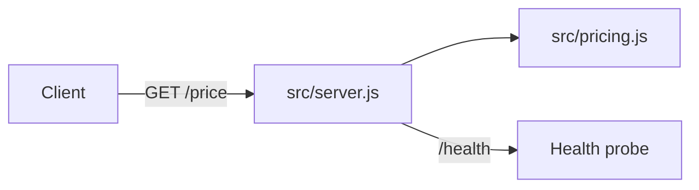
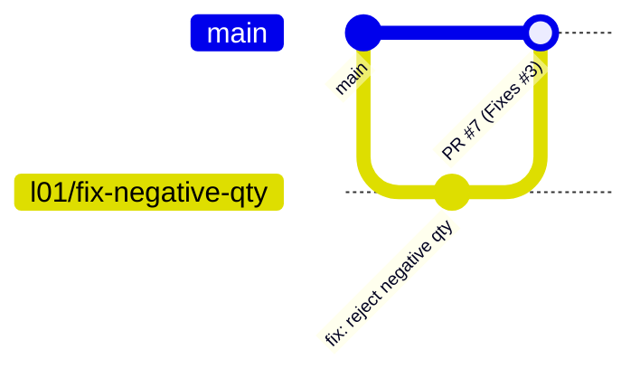
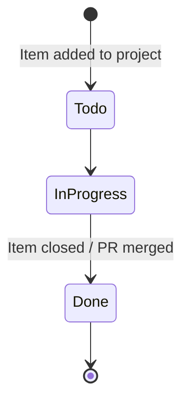

# Architecture and process (AZ-400 L03)

GitHub renders Mermaid diagrams in Markdown with a fenced `mermaid` code block.

## Request flow

## GitHub Flow used in this repo

## Issue lifecycle in the L01 Project

